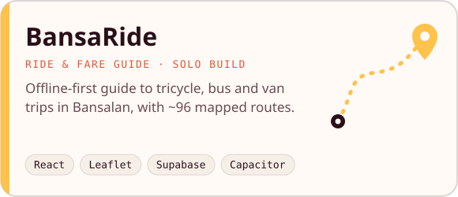
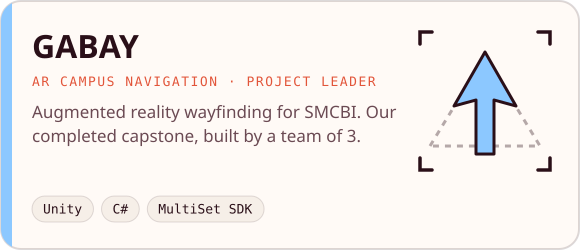
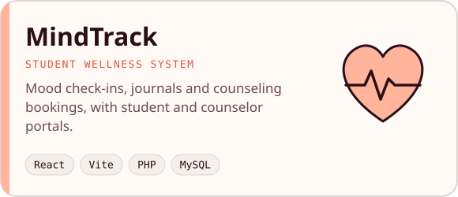
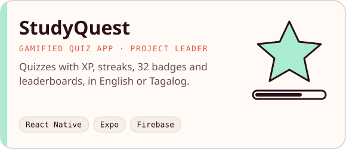

  
  
  
  
  
  

## About

I'm a fourth-year BSIT student who likes taking an idea from a sketch to something people can actually install and use. Most of my work sits between mobile, web and AR, and I usually end up handling both the interface and the backend.

- **Now:** looking for an internship where I can grow with a real team
- **Led:** the SITeS student society as president (2024–2025), and two app teams as project leader
- **Published:** first-listed co-author of a study on ICT integration in teaching, in the *Asian Journal of Education and Social Studies* (2025)
- **Outside code:** I write, edit and direct short films, like *Hi, Like You*

## Things I've built

<table>
  <tr>
    <td width="50%"></td>
    <td width="50%"></td>
  </tr>
  <tr>
    <td align="center"><a href="https://bansalanride.netlify.app/">Live app</a> · <a href="https://github.com/ItsmeEremiyaaaa/BansaRide">Source</a></td>
    <td align="center"><a href="https://drive.google.com/drive/folders/1UPTv_c1FwM8ssrSv6AWAYQaXkMfDeqtr">Project documents</a></td>
  </tr>
  <tr>
    <td width="50%"></td>
    <td width="50%"></td>
  </tr>
  <tr>
    <td align="center"><a href="https://mindtrack.page.gd/">Live site</a> · <a href="https://github.com/ItsmeEremiyaaaa/Mindtrack">Source</a></td>
    <td align="center"><a href="https://studyquest-a547c.web.app/">Web version</a> · <a href="https://github.com/ItsmeEremiyaaaa/StudyQuestTesting">Source</a></td>
  </tr>
</table>

Also: **GradeHub**, a grade management system for registrar, faculty and students (Laravel, React, TypeScript, Inertia.js).

## Toolbox

   
  

## Activity

  

  

<picture>
  <source media="(prefers-color-scheme: dark)" srcset="https://raw.githubusercontent.com/ItsmeEremiyaaaa/ItsmeEremiyaaaa/output/github-contribution-grid-snake-dark.svg">
  
</picture>

  Bansalan, Davao del Sur, Philippines · <a href="https://itsmeeremiyaaaa.github.io/Website-Portfolio/">See more on my portfolio</a> 
  

